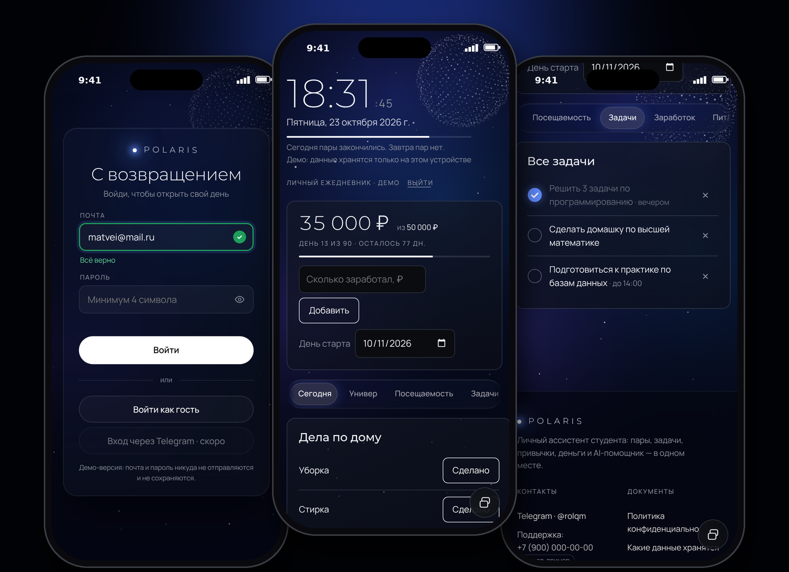
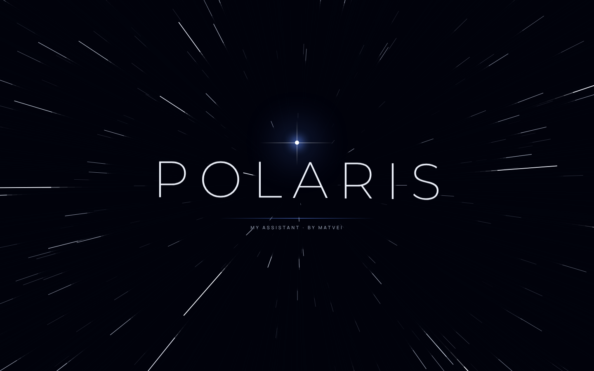
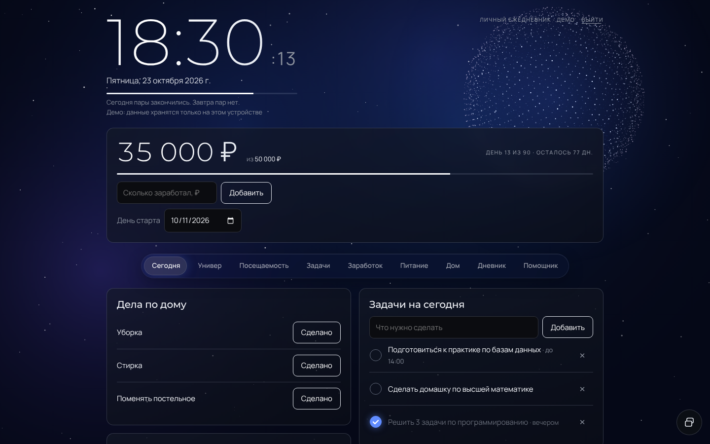
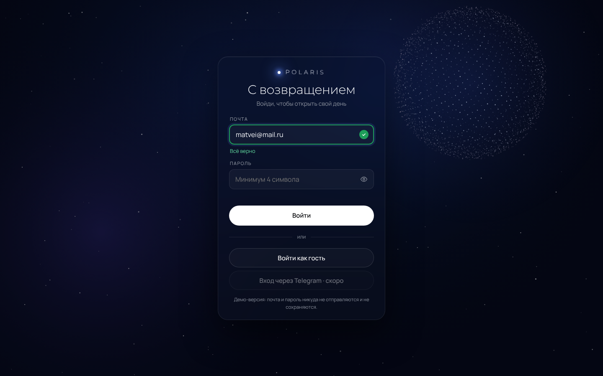

# ✦ Polaris — My Assistant by Matvei Kutafin

**Личный ассистент студента:** пары, задачи, привычки, деньги и AI-помощник — в одном красивом приложении. Работает в браузере на компьютере и ставится на iPhone как приложение.

🔗 **Открыть демо:** https://wrrxd.github.io/polaris/
💬 **Связаться:** Telegram [@rolqm](https://t.me/rolqm)



---

## Что умеет

- **Сегодня** — пары по расписанию, распорядок дня, задачи и привычки на одном экране
- **Напоминания о парах** — за 10 минут и в момент начала
- **Задачи и привычки** — отметка с анимацией, серии выполнения
- **Учёба** — расписание по неделям, папки предметов, посещаемость
- **Деньги** — цель и прогресс, история доходов
- **Дневник и AI-помощник** (в демо помощник отключён)
- **Работает без интернета** и ставится на экран «Домой» (PWA)

## Дизайн и анимации



- Тёмная тема «ночное небо»: живой звёздный фон, медленно вращается вокруг Полярной звезды
- 3D-сфера из 3400 частиц: следует за курсором и перетекает в куб
- Стеклянные карточки и меню-«остров» в стиле Apple
- Объёмная заставка: прыжок сквозь звёзды → название POLARIS волной → «пролёт» в приложение
- Микроанимации: галочки с пружинкой и искрами, уведомления, проверка полей на лету, кнопка-загрузка, модальные окна
- Уважает системную настройку «Уменьшить движение»




## Технологии

- **HTML, CSS, JavaScript** без фреймворков — один файл `index.html`
- **Canvas 2D** — звёздное небо, 3D-сфера, заставка
- **CSS-переменные** — вся палитра и шкала шрифтов в одном месте (`:root`)
- **Service Worker + Web App Manifest** — офлайн-режим и установка на телефон
- Данные хранятся только на устройстве (`localStorage`)

## Как запустить у себя

```bash
git clone https://github.com/wrrxd/polaris.git
cd polaris
python3 -m http.server 8000
```
Открыть в браузере: http://localhost:8000

## Структура

```
index.html             — всё приложение (разметка, стили, логика)
privacy.html           — политика конфиденциальности
sw.js                  — service worker (офлайн-режим)
manifest.webmanifest   — настройки установки на телефон
icon-*.png             — иконки приложения
*.png (скриншоты)      — картинки для этого README
```

## Конфиденциальность

Почта и пароль в демо никуда не отправляются. Всё, что ты вводишь, остаётся в браузере на твоём устройстве. Подробнее: [Политика конфиденциальности](privacy.html).

## Благодарности

Анимации основаны на библиотеке [Motion Prompt](https://showheyohtaki.github.io/motion-prompt/) (Shohei Ohtaki, MIT License). Оригинальные пометки с лицензией сохранены в коде.

---

© 2026 Polaris · My Assistant by Matvei Kutafin · демо-версия для портфолио
